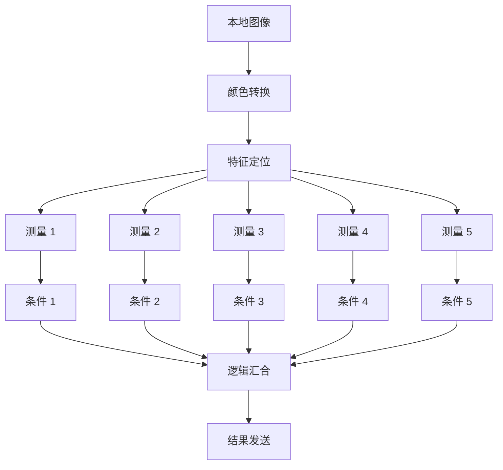

# 架构设计

## 1. 设计目标

- 基础模型独立于界面和编辑器库。
- 工具接入不要求调度器理解具体算法。
- 配置、运行、显示和存储职责清晰。
- 支持逐步扩展，不提前建设完整工业平台。
- 同一方案可在不启动 GUI 时加载和执行，支撑测试、自动化和后续现场集成。

本文落实 C01–C10 设计基线，不代表相关模块已经实现。
核心对象与契约以 [data-model.md](data-model.md) 为准；
手册依据、设计理由及阶段验收以 [requirements.md](requirements.md) 为准。
架构不得把早期调度、算法或存储后端的能力限制写成永久模型约束。

## 2. 模块职责

| 模块 | 职责 |
|---|---|
| core | 标识、数据类型、图像与几何、工具描述和执行契约 |
| workflow | 方案和流程模型、绑定解析、校验、执行计划及运行数据服务 |
| tools | 内置算法、逻辑及显式数据收发工具的实现和注册 |
| infrastructure | 方案读写、资源解析、日志和外部适配 |
| ui | 流程编辑、参数配置、图像与结果显示 |
| app | 模块装配、应用命令和生命周期管理 |

初期不要求每个模块独立发布为动态库。

逻辑分层与现有模块对应如下，不另建一套平行目录：

| 层次 | 模块 | 主要责任 |
|---|---|---|
| 应用层 | app、ui | 应用装配、无 GUI 入口与桌面交互 |
| 核心层 | core、workflow | 类型契约、模型、绑定、结果和执行控制 |
| 能力层 | tools、infrastructure | 具体算法、方案存储、设备及通信适配 |

分层表达职责，不表示核心层直接依赖所有能力实现。

### 2.1 S2 在整体架构中的位置

S2 实现 core 的基础类型与契约，以及 workflow 中的配置模型、校验和绑定解析。
这些内容既包括方案、节点、图像等领域对象，也包括复制重映射、结构检查和按运行取值的实际逻辑。
后续执行器、算法工具和界面共同使用这些接口，不另建各自的身份与数据模型。

以下按参考软件中可观察的功能说明本项目的分工；依据见 [requirements.md](requirements.md) §2，
不据此推断 VisionMaster 内部使用相同类名或实现架构。

| 功能 | S2 提供的基础 | 后续接入 |
|---|---|---|
| 方案、流程、模块参数及 Group 公开边界 | Solution/Workflow/Node、工具元数据、公开 Schema、包含关系及配置快照 | S3 运行与保存加载；S5 编辑界面；S6 完整 Group 执行与复用 |
| 控制连线、分支和汇合 | 控制图、出口定义及控制/数据依赖联合校验 | S3 调度器决定何时调用、等待或关闭路径，并处理失败和取消 |
| 图像源和参数结果订阅 | Binding、结构化引用、Validator/Resolver，按本轮上下文定位和检查已有数据 | S3 在节点调用前解析输入，并根据就绪状态安排执行 |
| 图像、ROI 与位置修正 | 只读所有权、视图持有、区域和坐标模型及校验 | S4 算法适配；S6 完整形状、标定和设备缓冲适配 |
| 模块输出、状态和结果查询 | NodeResult、输出有效性、运行身份及最小结果访问结构 | S3 结果提交、生命周期及完成事件；S5 显示与观察订阅 |
| 全局变量、队列和外部设备 | 定义、消息类型、关联身份及资源引用，必要时用测试替身验证取值 | S6 共享读写、排队消费、业务汇合和设备通信服务 |

BindingResolver 负责数据定位和取值，不负责节点调度。
S2 用人工结果判断值、未就绪和错误；由 S3 调度器决定等待或结束，解析器不阻塞等待生产者或补跑来源。
同流程只读图像共享属于所有权和访问契约，不等于跨流程消息传输或外部通信已经实现。

S2 的结果访问结构以方案会话为边界，按 InvocationKey 寻址；跨会话记录补充会话身份。
人工结果的重复键处理不能静默覆盖已有结果，但其单线程验证不代表 C08 的原子终态提交、
取消竞争或迟到回调已经验证。运行句柄与工厂在 S2 形成可编译接口，S3 再实现运行服务与装配。
实施顺序及验证方式见 [development.md §5](development.md#5-第二阶段实施与验证)。

## 3. 依赖方向

- core 不依赖其他业务模块。
- workflow 和 tools 依赖 core。
- workflow 通过工具接口调用具体实现。
- infrastructure 可以依赖 core 和流程配置模型。
- ui 使用应用命令修改配置和请求运行。
- app 装配具体实现。

初期通过静态工具注册表提供类型描述和运行实例工厂。
app 注册具体能力，WorkflowEngine 通过注册接口创建和调用工具，
不在引擎中按具体算法类型编写分支，也不加载动态插件。
数据绑定解析先于或伴随执行器实现，不能在调用接口固定后再补取值语义。
第三阶段即验证分叉、汇合及基本条件分支，单线程就绪调度即可承担该阶段范围。

core 和 workflow 不依赖 GUI、具体流程编辑器或设备 SDK。
核心领域类型优先使用标准 C++ 类型。
OpenCV 的图像表示可通过受控封装使用，不追求无实际收益的完全隔离。
无 GUI 不等于禁止所有非界面的 Qt 组件；核心执行不能要求窗口、控件
或 GUI 事件处理才能完成。非界面依赖按模块职责评估。

### 3.1 应用调用边界与后端适配

GUI、无 GUI 入口及后续外部调用共用应用服务：
加载/保存/关闭方案，枚举流程/端口，提交 RunRequest，等待/取消 RunHandle，查询结果及订阅事件。
接口不暴露 QWidget、QAxWidget、厂商指针或厂商异常；
应用服务以 core/workflow 契约为基础，由 app 装配具体存储、执行和设备后端。

SDK 的 Solution/Procedure/Group/Tool 分层支持细化调用边界，
但本项目不照搬其进程单例、显示名索引或 void* 对象访问。
若以后接入该 SDK，适配层负责稳定身份映射、UTF-8/原生路径转换、像素/角度转换、
状态码归类、结果物化及调用能力检查；第三方头文件不进入核心公共接口。
后端明确支持的同步/异步、线程安全、并发、一次性输入、结果寿命与关闭协议，
不能从“存在 Run 方法”推断可重入，也不从示例枚举值推断所有工具能力。

这些服务先以本项目原生执行器和模拟后端验证，不因参考 SDK 而引入 COM/ActiveX、
厂商运行时或旧版 Qt 依赖；具体集成属于后续独立适配工作。

## 4. 配置模型与编辑器

VisionPro 的领域模型是流程配置的事实来源。

编辑器通过适配层：

- 读取节点、控制出口、输入输出定义与连接。
- 发起节点增删、控制连接、输入绑定和参数修改命令。
- 将模型变化映射到画布。
- 保存节点位置等布局信息。

不长期维护两套各自可独立修改的流程配置。

流程编辑器的实现方案尚未确定。
画布主连线用于执行编排，普通节点允许多个前驱和后继；
输入源与结果订阅通过独立配置界面表达。编辑器选型必须满足该图模型。
可按需显示只读的数据依赖辅助视图，但不改变主连线语义。
工具元数据驱动输入源选择、参数编辑和可订阅结果列表。
编辑动作、结果变化及参数预览不直接触发算法执行或数据消费。

常规编辑器复用参数的类型、范围、单位及绑定能力；复杂 ROI、模板训练使用专用组件。
显示分组、可见性和叠加样式属于 UI 元数据，不参与算法取值或调度。
训练模板、连接设备和刷新设备列表是显式应用命令，不能伪装成参数赋值的隐含副作用。
命令产生的模板等资源通过配置修改纳入后续快照，不改变正在运行的资源版本。
单节点/Group 调试通过显式独立调用提交完整输入，使用独立结果身份和声明的状态策略；
参数预览不能伪装成调试执行，控件刷新也不能代替运行完成信号。

## 5. 配置与执行

编辑模型在领域和运行前校验通过后生成执行快照。
加载校验与执行校验分开：缺工具/资源的模型可带诊断编辑，不能误执行。
执行计划由快照和执行器能力共同决定；计划生成失败不删除模型中的合法目标结构。

ExecutionPlanner 在不可变配置快照上复用 BindingValidator，生成只读 ExecutionPlan。
计划包含控制图及入边状态规则、由绑定派生的依赖约束、来源作用域及所需资源能力，
并关联配置快照身份、工具定义版本和执行器支持范围。
运行只持有一份计划；编辑后重新校验生成新计划，仅供后续运行使用。
计划是可重新生成的运行产物，不作为方案文件中的另一份可编辑流程。

规划检查稳定标识、绑定/选择器/转换、控制激活、作用域及不支持能力。
控制关系决定执行许可，数据就绪约束可细化未规定的顺序；
例如同一分叉下已激活的兄弟节点可以按依赖先后执行。
不能反转明确控制顺序、激活未选分支或补跑副作用来源；Optional 不放宽该规则。
控制、数据与已声明资源等待约束共同校验，不能只检查数据图无环。
资源能力在规划时校验；连接、占用及设备断开等动态状态在运行时另行处理。

职责按以下路径分开：

```text
ToolDescriptor：工具类型及输入输出、参数元数据
Node：方案中的模块配置与绑定
Node 配置快照 → 工厂创建 ToolInstance → 执行产生 NodeResult
```

Node 是配置，不兼任执行对象；ToolInstance 是运行实例，不负责编辑或保存方案。
实例只能使用当前快照和本次已解析输入，不能借用可变编辑配置绕过快照边界。
实例创建失败应报告节点诊断，不删除或改写配置。
停止或释放运行实例不删除节点配置，编辑节点也不直接重置正在使用的实例。
跨调用状态由 NodeState 的作用域和重置策略管理，不保存到 Node 或结果历史中。
实例寿命可按调用、运行或会话声明，状态寿命独立选择 Invocation、WorkflowRun、SolutionSession。
首批可以每轮创建实例，但通过 NodeStateStore 保留会话状态并协调首次 Init；
不得因此把跨轮累积或首次初始化降成每轮重置。
工具声明配置兼容性，不兼容配置创建新状态代次，在途快照继续使用原代次。
同类型节点互不共享可变状态，改名和布局变化不重置状态。

WorkflowEngine 是运行服务，Workflow 是可持久化模型，二者不互相兼任。
详细配置与运行边界见 [data-model.md](data-model.md)。

运行上下文保存：

- 本次运行标识。
- 节点输出与诊断。
- 取消状态。
- 执行统计。
- 本轮工具状态及对受控会话服务的访问入口。

运行上下文不回写节点配置。
外部图像、标量或 ROI 经 RunRequest 与快照一起受理；Busy 不修改待运行输入。
工作流公开端口映射到内部绑定，每轮输入独立且默认不持久化，详见 data-model §4.1。
运行期间的编辑何时生效由应用策略决定，
不得使同一轮执行混用不同版本的参数。

一次节点调用按以下顺序处理：

1. 调度器按控制到达/关闭状态确定执行许可，并按数据就绪条件排入可执行队列。
2. 启动前检查取消，在本次运行/作用域中解析输入与可订阅参数；Pending 不能提前变为 None。
3. 校验类型、选择器、转换、范围与坐标，固定本次调用输入。
4. 获取状态域及资源访问权，创建 InvocationOperation；同步执行或等待异步完成通知。
5. 校验输出契约、身份及尝试提交资格，一次性接受结果和终态，并一致地产生控制完成事件。
6. 引擎根据已接受状态及已验证出口选择推进/关闭后继；真正启动后继前再次检查取消。
7. 实际操作退出后归还租约并释放不再需要的对象，不以逻辑终态替代物理退出。

InvocationOperation 持有快照、固定输入、状态/资源访问和取消入口。
异步工具不得在回调仍可能使用数据时释放这些对象；同步返回不得遗留未追踪的后台业务操作。
工具只报告结果及允许的出口选择，不直接调度后继。预期错误返回诊断，异常在调用边界截获。
初始化准备状态和资源，业务采集、消费、发送仍是显式调用。

绑定不自动调度源节点。合法路径上的来源尚未完成时可等待其就绪，
确定不可能产生必需值时报告缺失/依赖错误，不能自动读取上一轮值或改变明确编排顺序。
例如控制顺序为 B → A，而 B 必须读取 A 的本轮输出，应报告依赖冲突，
不能自动补跑 A；A 可能执行采集、队列消费或通信操作。
外部读写、全局写入和队列消费由显式操作负责；输出发布不表示这些操作可整体回滚。

第三阶段可采用单工作线程就绪队列和每流程 maxInFlight=1；重复启动返回 Busy，
不隐式排队、替换或取消旧运行，槽位保留至实际调用和清理完成。
该策略不限制图的分叉/汇合，也不是方案会话全局互斥。
本阶段默认 FailFast、无自动重试；未处理技术失败终止后续调度，未开始节点记录原因，NG 不自动终止。
目标模型还支持独立路径继续、显式错误处理和安全重试，按工具能力与流程策略启用。
已处理失败不改写原节点状态；重试中间失败不提前触发最终错误出口。
连续/外部触发、重入和并行的准入与取消范围分别声明，资源冲突只约束相关操作。
超时或取消使结果失去提交资格，不表示工作线程、设备操作或资源租约已经结束；
实例与资源仍需保留至实际操作退出，清理未完成前不能对同一实例或独占资源启动冲突操作。
支持异步等待后采用事件通知或条件等待，不能通过持续空转检查就绪状态。

无 GUI 验证先采用内存配置和模拟工具，随后接入配置存储和真实算法。
每次调用记录配置快照身份、运行与调用标识、实际来源、顺序及诊断，
支持追溯但不默认保存全部图像缓冲区，也不声称外部副作用可精确重放。

### 5.1 单次、连续与停止

单次运行的同步等待与异步受理复用同一调用契约，RunHandle 明确受理、完成和实际退出。
连续运行由运行控制服务反复提交新轮次，每轮重新绑定输入与配置生效点；
间隔是“完成后延迟”还是“固定周期”、超期如何排队/丢弃请求，均须声明，不能靠定时器重入推断。

StopContinuous 先停止创建后续轮次，当前轮次按明确的排空或取消模式处理；
CancelRun 针对具体已受理运行，WaitForQuiescence 等待实际退出。
等待超时返回仍未退出的状态，不表示线程被终止或资源已释放。
方案级命令固定参与的启用流程集合，保留每个 WorkflowRunId 及整体摘要，
不能只返回一个 bool 隐藏某个流程未受理/失败；并行与聚合在第六阶段实现。

### 5.2 会话切换与退出

app 显式协调启动与 shutdown；加载/保存/导入/关闭有独立管理操作身份与结果，
不把进度事件或“结束”回调直接视为成功。
加载候选模型成功后再切换活动会话；后端单例限制或加载期间接口不可调用时，
由该后端管理命令串行化/停稳处理，模型加载失败保护仍须成立。

退出顺序为：停止新请求和触发 → 关闭可选观察交付、请求排空/取消
→ 保持必要完成/退出通知直到活动操作实际退出 → 撤销底层回调并等已进入回调退出
→ 释放结果/状态及资源访问 → 关闭连接/后端 → 最终进程资源清理。
具体后端若要求不同依赖顺序，须声明并验证，但不能提前销毁回调用户对象或图像缓冲。
厂商要求显式调用的 DisposeResource 与控件 dispose 位于对应生命周期中，
不因此否定普通资源的 RAII，也不把窗口析构作为整个核心系统的退出入口。

## 6. 三类关系

- 控制关系：描述执行顺序及控制转移。
- 数据关系：描述输入从何处获取数据。
- 包含关系：描述节点属于哪个流程或结构化容器。

三类关系不能互相替代。
控制连线不隐含数据绑定，数据绑定不直接触发执行。
数据依赖仍约束控制关系的合法性，必须检查来源在当前路径中能否产生有效输出。

循环不能仅靠允许任意回边获得语义。
跨流程传递不能仅靠放开普通数据引用获得同步保证。
分支可能激活一个或多个出口，多出口不自动意味着并行执行。
循环需要独立执行作用域；汇合需要定义哪些分路应到达以及如何处理未执行分路。

C06 的详细语义以 data-model §5.2–§5.4 为准，架构责任如下：

- 控制图支持普通节点多前驱/多后继，无条件分叉激活全部后继，条件出口允许零个、一个或多个。
- 引擎按运行/作用域维护每条入边的 Pending、Arrived、Closed(reason)，处理重复通知和嵌套关闭传播。
- 触发向显式入口注入一次启动许可；规划诊断范围外前驱连入执行节点的情况，不能保留无完成来源的等待。
- AllActivated 等全部入边已确定及参与路径完成后，至少有一条有效到达才执行节点一次。
- 全部正常未选时不执行并传播关闭；失败/取消不能冒充 NotSelected，按 C08 处理并解除等待。
- 汇合策略附着节点控制配置和计划，不强制画布插入虚拟业务节点。
- MergeValues 是显式数据聚合，控制到达不自动决定缺失字段取值。
- 循环区域生成迭代子作用域，对外显式 First/Last/Collect/Reduce；零次和失败规则已在模型中定义。
- 跨流程 CorrelationJoiner 是业务数据服务，不复用流程内控制到达语义。

第三阶段实现分叉、AllActivated 和基本分支；完整循环、多流程并行在第六阶段推进。
AnySelected 等提前继续策略在剩余工作取消/收尾规则明确后再开放。
复合 Group 封装子图和公开输入输出，纯画布分组不产生运行作用域；
查询接口分别提供当前层和递归层级，独立 Group 必须显式注入宿主资源和状态服务。
Group 与循环的边界规则见 data-model §5.5，完整 Group 执行与复用在第六阶段实现。

下图对应手册图 3-2 的编排需求；线条仅表示控制，数据经独立绑定获取：



五条路径全部激活，逻辑和发送各调用一次。单线程也必须满足此语义；
真实颜色测量和通信适配按对应工具阶段验收，模拟执行不能充当真实设备证据。

## 7. 运行数据服务

| 服务 | 职责与作用域 |
|---|---|
| BindingResolver | 解析类型化引用，不拥有共享业务值，也不消费队列 |
| ResultStore | 保存按运行、作用域和调用区分的节点结果 |
| GlobalVariableStore | 在方案会话内提供共享当前值、版本和受控读写 |
| DataQueueStore | 在方案会话内管理有界 FIFO 消息及显式消费 |
| NodeStateStore | 管理按节点与状态作用域隔离的累积或初始化状态 |
| 事件交付适配 | 分离内部完成、业务结果和显示通知，管理订阅/注销、队列容量与来源身份 |

这些服务属于 workflow 的逻辑职责，不要求各自建立独立库或通用框架。
结果历史显示可以维护索引，但不能将“节点最新结果”作为运行时引用解析依据。
需要保持的图像结果必须具有有效所有权，历史缓存应按条数、字节或时间设置保留上限。
活动调用、队列和共享值仍持有的缓冲区不能被历史淘汰强制释放。
容量不足时明确拒绝、等待或按已声明策略丢弃，不能通过丢弃必需业务数据伪装成功。

全局变量支持显式读写工具及元数据允许的只读 GlobalReference；
后者记录版本与取值时机，批量一致读取由共享服务提供，写入仍是显式副作用。
多个全局值的一致快照不代表它们属于同一工件，仍需关联标识或明确同步。
队列传递完整记录；多生产者的字段先按关联标识汇合，再原子入队。
需要组合消费多队列时，必须定义齐备与消费原子性，避免只取走部分数据。
等待应可取消，不阻塞 GUI；队列容量、超时和溢出策略需在实现前明确。

脚本复用普通工具的输入输出契约，以受控接口访问共享服务，
不直接访问 GUI、全局容器或其他节点的可变内存。

SDK 回调可来自后台线程且影响下一轮启动。适配器只完成必要校验、数据物化/持有与入队，
引擎校验身份后提交，UI 再于 GUI 线程显示，不能在回调中同步渲染或等待本运行。
可选结果通知与必要结果物化分别控制；禁止因关闭显示回调而断开数据依赖或控制推进。
注销返回不自动证明回调已退出，订阅对象须在后端确认无回调访问后释放；
如果关联身份不充分，只收窄该后端对象的在途范围，不能将限制传播为全方案单链。
脚本语言与执行后端不在当前阶段选定。

## 8. 图像与结果

- 图像缓冲区拥有者与读取者必须明确。
- 节点输出发布后按只读共享处理。
- 原地修改需要独立所有权或显式复制。
- 几何结果与显示叠加层分开。
- ROI 保留浮点几何、局部方向、继承/排除与修正，不默认取整数包围框。
- 工具声明格式、几何/掩膜及组合能力；坐标、单位和变换在适配层显式转换。
- 外部图像校验格式、步长、尺寸和缓冲长度，结构浅拷贝不延长借用数据寿命。
- 结果适配逐输出检查状态与数量；源节点成功不自动意味着每个输出都可用。
- 结果带运行来源，避免显示或消费过期数据。

固定资源版本、动态采集图像和显示历史分别管理；
图像裁剪视图持有父缓冲，历史淘汰只释放自身引用。

## 9. 资源与持久化

方案配置引用资源，资源解析由独立服务负责。

设备连接与节点执行实例分离：infrastructure 中的相机、通信适配器拥有连接和 SDK 句柄；
core 声明工具所需的最小资源能力接口，app 在无 GUI 和 GUI 入口注入相同服务。
ToolInstance 通过 ResourceId 获取受控访问或租约，只执行采集、发送等具体操作。
节点释放不默认断开其他节点正在使用的连接，资源服务负责最终关闭与清理。
共享连接不代表设备可重入；独占、串行访问、超时和断连恢复在接入该资源前确定。
当前仅确定上述边界，不预先建设完整 CameraManager 或 CommunicationManager 框架。

资源目录区分托管版本、外部文件、目录/图像序列、设备逻辑引用和输出路径/命名。
固定模板/标定版本随计划锁定；动态输入在采集时读取并追溯实际来源。
用户可选择保留引用或嵌入，便携导出须报告残留外部依赖。
相对路径有显式基准，不能依赖进程工作目录；保存不改写外部文件。

方案格式不直接等同于内存对象布局。
方案版本、工具配置版本和资源引用规则分别定义。
全局变量保存类型与初值，队列保存消息定义和容量策略；
当前共享值、积压消息、工具累积状态与运行结果默认不属于方案文件。
后续如需恢复运行状态，应单独设计检查点机制，不改变普通配置保存的含义。

首个后端采用目录加 JSON 清单，托管资源先写不可变新版本，清单以同文件系统临时文件原子提交。
提交前失败不破坏旧方案，提交后清理失败单独报告；修订比较与提交由同一后端协议保护，
无法协调的第三方写入按实际能力报告，不把单次预检查当作原子防冲突。
文件解析、领域诊断与执行能力校验分层；缺资源/工具可诊断编辑，不误执行。
未知内容只有能无损保留才允许往返，否则禁止有损覆盖。
单文件、打包或加密作为后续后端能力，不改变领域契约。
流程/Group 复用采用明确端口 Schema 与资源依赖清单，导入新实例须重映射内部身份，
不能按显示名称绑定目标方案同名对象，也不导入运行状态；完整功能在第六阶段实现。
具体保存/加载规则见 data-model §10。

## 10. 暂缓设计

以下能力先记录需求与边界，不在第一阶段实现：

- 通用并行调度器。
- 动态插件 ABI。
- 脚本运行时。
- 完整设备管理框架。
- 自动格式迁移引擎。
- 任意类型的动态数据系统。

## 11. ANS1 设计建议采纳记录

2026-10-26 对外部设计稿 ANS1.md（V0.1，三节架构建议）与现有文档进行对照。
该稿作为设计输入，其示例代码不是已实现接口，内部实现推断不作为事实依据。
以下为结合 C01–C10 审阅修正后的当前取舍；手册依据已在 requirements §2 按章节和页码单独核对。
现有技术栈、目录职责及六阶段路线继续有效，第三阶段补入分叉/汇合/基本分支，
不将稿件中的“V1.0”直接作为交付承诺。

| 设计稿章节与思路 | 结论与理由 | 文档落点 |
|---|---|---|
| §1.1–1.6 类型、配置、实例分离；静态注册；结构化输出 | 采纳并沿用已有原则；统一为 ToolDescriptor、Node、ToolInstance、NodeResult，不另建 Module 系列模型 | 本文 §3、§5；data-model §2 |
| §1.1–1.3 资源服务独立、数据/资源/触发分开 | 采纳；补充连接所有权、访问租约和显式命令，避免节点销毁误关共享设备 | 本文 §4、§9；data-model §5、§10 |
| §1.2、§1.7、§2.10、§3.12 的 V1.0 范围 | 调整；三类工具不是产品范围上限，特征匹配、通信、多流程与循环不同时进入最小闭环 | requirements §5–§8 |
| §2.3 DataValue / TypeRegistry | 采纳强类型契约；首批用有限静态类型和明确记录，动态载荷、通用类型注册及 ABI 后置 | data-model §4 |
| §2.4、§2.9 与 §3.6 的输出地址 | 必须统一；RunId + 节点无法区分循环调用，沿用 InvocationKey；AttemptId 区分重试尝试，不另设平行 ActivationId | data-model §8 |
| §2.2.2、§2.5 字符串路径、GlobalVariable、Expression、历史引用 | 调整；结构化标识；显式读写/计算工具和声明允许的版本化全局读取，LatestAvailable 不进入普通绑定 | data-model §3–§5、§11 |
| §2.5、§3.4.2 必需缺失及 Optional | 必须统一；声明的缺失、生产者失败、选择器错误不同，Optional 不能吞掉类型错误或失败 | data-model §5；本文 §5 |
| §2.6–2.8 只读图像、有界缓存及业务关联 | 采纳；补充 SDK/ROI 视图所有权和活跃引用保留；共享所有权不自动保证只读或内存有界 | data-model §6、§8、§12 |
| §3.1–3.4 控制图、派生依赖与执行计划 | 采纳；多前驱/后继，绑定不激活节点；数据就绪可细化未定顺序，不反转明确控制 | 本文 §5–§6 |
| §3.5 分支、汇合和循环 | 采纳并分阶段；第三阶段验收基本分支/AllActivated，完整循环后置；控制等待与数据合并分开 | 本文 §6；data-model §5.2–§5.4 |
| §3.6、§3.8 运行/图像/工件身份及多流程 | 采纳；身份各自独立，关联键须有可靠来源；maxInFlight=1 收敛为首版重复启动拒绝 | 本文 §5；data-model §8、§12 |
| §3.7.3、§3.9 原子发布、取消、重试 | 采纳原则并修正伪代码漏洞：提交被拒后不能仍传播控制；逻辑终态与物理清理分开，外部副作用不能回滚 | 本文 §5；data-model §8 |
| §3.10–3.13 接口草案、目录及“冻结”建议 | 仅采纳职责；继续使用现有 core/workflow/tools/infrastructure 分层，不复制 src/core 全包式目录，不据此增加 DSPatch 或其他依赖 | 本文 §2–§3；data-model §15 |

C01–C10 的身份、几何、状态、控制及存储设计基线见 [data-model.md](data-model.md)，
具体 C++ 签名、后端细节与分阶段待办见其 §15。
不再沿用早期“仅顺序结构”或“实例寿命决定状态寿命”的收窄解释；
2026-10-26 的上述取舍记录不单独构成阶段验收；2026-10-27 的 S1 结论为
**文档审查通过，相关能力尚未实现**，见 [development.md 的审查记录](development.md#81-s1-文档审查记录)。

## 12. SDK 指南补充的设计取舍

依据为 [SDK 开发指南 V4.3.1（C++）](<Manual/VisionMaster算法平台SDK开发指南V4.3.1（C++）.chm>)，
具体章节/接口与版本差异见 requirements §2.1。以下是本项目决策，不推断厂商内部算法。

| SDK 中可观察的接口/用法 | 本项目采纳或调整 | 契约落点 |
|---|---|---|
| Solution/Procedure/Group/Tool 分层、Run 的等待选项 | 统一应用服务与显式作用域，返回可追溯运行句柄；不采用进程全局单例作为领域模型 | C01、C06、C07 |
| SetInputImage/ROI 每次执行后清空 | 一次性类型化运行输入与快照一起受理；重试复用同一数据并按适配器要求重新注入 | C03、C04 |
| Group 动态端口、独立加载和分层模块枚举 | 复合子图公开 Schema、宿主依赖和层级查询；不允许外部任意穿透内部结果 | C01、C04、C06、C09 |
| GetResult 刷新、nValueStatus 与结果缓存 | 物化本轮不可变结果，逐输出校验；SDK 缓存不代替 ResultStore 的身份和保留契约 | C02、C03、C08 |
| 几何 ROI 与 mask 设置 | 补齐 RasterMask 与转换/组合能力；互斥限制归具体工具，不降低通用区域模型 | C05 |
| 回调线程、启停回调、异步控件刷新 | 内部完成、业务交付、UI 观察分层；注销须确认静默，显示刷新不作为完成依据 | C07、C08、C10 |
| 管理接口非线程安全、StopRun 等待、DisposeResource | 后端命令协调、连续停止与取消分离、显式退出；不照搬析构样例，不引入全方案执行锁 | C01、C06、C07 |
| 多类错误码、版本升级和弃用接口 | 保留原始错误域/码与后端版本，按接口能力映射；迁移/SDK 环境另行验证 | C08、C09、C10 |

SDK 的字符串参数/名称路径可用于外围映射，不代替本项目稳定 ID 与强类型绑定。
Qt5.0–5.10、MSVC、QAxWidget 等是该版厂商控件章节的描述，不是本项目依赖版本决定。
本文未引入 SDK 链接、控件嵌入或方案格式兼容承诺，也未将 SDK 样例视为已运行证据。
