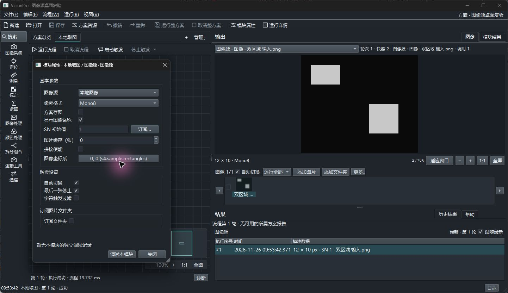
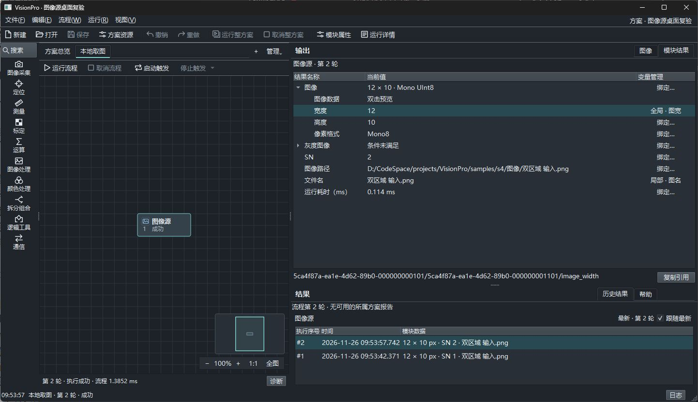

# 图像源节点设计

采集工具箱只提供一个「图像源」。同一个画布节点可以在本地图像、相机和 SDK 之间切换，原有主图订阅继续使用。现有方案中的三个旧工具由加载器迁移。第 1–7 节给出手册依据、设计和验收场景，第 8 节记录项目实现与设备验收边界。[交互原型](image-origin-prototype.html)

## 1. 手册依据与节点边界

项目与海康手册的模块名称均为「图像源」，工具类型 ID 为 `visionpro.image.source`。下表均为印刷页码。

| 资料 | 对设计有直接影响的内容 |
| --- | --- |
| 新版[图 3-4、表 3-5，第 39–41 页](../Manual/VisionMaster算法开发平台_用户手册_4.4.3Lite_20260515.pdf#page=53)，[图 4-11，第 59 页](../Manual/VisionMaster算法开发平台_用户手册_4.4.3Lite_20260515.pdf#page=73) | 流程编辑区在左。主界面右上为图像显示区，右下为结果显示区。单击模块后两者跟随所选对象。 |
| [图 4-19，第 66 页](../Manual/VisionMaster算法开发平台_用户手册_4.4.3Lite_20260515.pdf#page=80)，[第 255–257 页](../Manual/VisionMaster算法开发平台_用户手册_4.4.3Lite_20260515.pdf#page=269) | 双击图像源后，在配置窗口的「基本参数」选择来源。添加图片和文件夹在主工作台「图像」页，图中可同时看见两处。 |
| [图 10-10，第 260 页](../Manual/VisionMaster算法开发平台_用户手册_4.4.3Lite_20260515.pdf#page=274)，[图 10-11，第 261 页](../Manual/VisionMaster算法开发平台_用户手册_4.4.3Lite_20260515.pdf#page=275) | 前图用 Blob 示范共享「模块结果」的表格、变量绑定和 SDK 引用。后图直接展示图像源的实时图、样图栏，以及右下的「历史结果／帮助」。 |
| [第 153–157 页](../Manual/VisionMaster算法开发平台_用户手册_4.4.3Lite_20260515.pdf#page=167) | 多数算法模块可在属性中配置输入、运行参数及「结果显示」。后者定义判定、图形、文字渲染。图像源的实际参数分组以图 4-19 和本节点专章为准。 |
| [图 13-3，第 301 页](../Manual/VisionMaster算法开发平台_用户手册_4.4.3Lite_20260515.pdf#page=315)，[§13.1.1，第 296–307 页](../Manual/VisionMaster算法开发平台_用户手册_4.4.3Lite_20260515.pdf#page=310) | 全局相机管理负责设备配置。图像源按来源列出适用参数和输出，节点关联已有相机，可绑定曝光、增益。 |
| [旧版用户手册](../Manual/VisionMaster算法平台用户手册V3.0.2.pdf)，§4.2–4.4 第 25–28 页 | 本地图像与相机图像各有入口。旧版明确列出本地取图间隔。VisionPro 可在连续执行操作中保留该节拍设置；新版图像源专章未将其列入默认参数表。 |

节点负责取得本轮的原始图、按选项生成灰度或拼接图，并发布这一调用的结果。设备连接和物理触发设置由相机管理负责。多图采集、输出图像、缓存图像、光源仍是独立工具。「方案存图」保存调试用源图；生产结果归档由输出图像工具负责。

## 2. 参数、图像和结果分别在哪里

**双击节点打开参数窗口，单击节点在主工作台查看图像和模块结果。** 右上「图像／模块结果」是同一区域的两个页签。右下按模块类别展示执行信息；选中图像源时只列历史结果，另有帮助。图 4-19 展示的是参数窗口与主工作台并排可见的状态。第 264 页另述的「综合配置」是从快捷工具条打开的方案级调试功能。

### 2.1 流程画布和参数窗口

从「采集 → 图像源」拖入画布，单击选中，双击或选「模块属性」打开参数。属性窗口固定显示所编辑节点的名字。采用 VisionPro 既有非模态属性宿主，默认显示在画布一侧，让右侧图像区可继续操作。图 4-19 可以确认两处控件的归属；浮动、停靠、提交和撤销方式属于项目实现选择。

参数窗口采用可滚动的单列属性表。标题下从「基本参数」开始，左列字段名，右列下拉框、开关、数值或来源选择器。第一行「图像源」可选本地图像、相机、SDK；不同来源只显示适用项。可订阅字段在值右侧显示绑定按钮，选择订阅时显示来源与类型。展开开关的从属项紧跟开关，校验错误显示在相应行。

| 来源 | 基本参数及展开项 | 触发设置及其他分组 |
| --- | --- | --- |
| 本地图像 | 像素格式、方案存图、显示图像名称、SN 初始值、图片缓存；彩色时可开「输出 Mono8」。拼接使能展开起始高度、拼接高度、触发清空及触发变量。 | 自动切换、最后一张停止、字符触发过滤（输入字符／触发字符）。「订阅图片文件夹」独立成组，含路径、更新缩略图、触发流程执行。 |
| 相机 | 图像源之后先选「关联相机」，右侧可进入相机管理。按需控制曝光、增益，然后设置 SN 初始值、输出 Mono8 和拼接。 | 字符触发过滤。物理触发模式在相机管理中配置。既有方案「主动取帧／使用本轮输入帧」作为 VisionPro 的流程接入设置。 |
| SDK | SN 初始值、输出 Mono8、拼接及触发清空。宿主送来的图像属于本轮输入。 | 字符触发过滤。示例送帧和测试输入归独立调试操作；正式 SDK 接入见 §3.3。 |

图 4-19 的本地示例为 MONO8、显示图名开启、SN 为 1、图片缓存为 0。本设计采用这些初值，图片缓存上限 5 张。新建节点的图像清单为空；原型预置样图供试用。枚举和开关沿用工作台的即时编辑，数值确认有效后提交，方案修改可撤销。关闭属性窗口后，工作台仍可导图、执行、查看结果。正式「执行一次／连续执行／停止」在流程工具栏；项目已有的「调试本模块」继续使用隔离会话，明确标记调试来源。

可通过「关联相机」下拉框右侧的相机图标或主工具栏的「相机管理」进入全局相机管理。该窗口为关联设备设置主动取帧模式、超时和模拟频闪通道。图像源属性另有「相机接入」页，配置流程帧触发、坐标系与取帧方式。旧设备继续在该页使用原节点的模式和超时。「SDK 接入」页负责本轮图像输入绑定，送帧测试位于流程运行输入或独立调试窗口。

### 2.2 主工作台右上「图像」

从上到下为图像选择与视图工具、预览画面、本地图像栏。图像选择器可切换当前模块主图、灰度图或实际有值的拆图；视图提供缩放、自适应、全屏，复用公共图像工具。预览显示文件名或帧身份、尺寸、像素格式。未执行时导入的样图标为「本地预览」，运行后显示所选调用标识。

本地模式下，在**预览画面下方**添加单图、添加整个文件夹、清空或回首张，勾选缩略图，选择「运行全部／运行选中」。画面两侧切换图片。图片栏的「自动切换」和属性窗口的同名开关写入同一个节点配置。浏览、勾选、运行是三个独立动作。相机与 SDK 模式收起本地图片栏。若节点有灰度／拆图等多个结果，经上方图像选择器切换；这些是同一次取图的不同输出，和下方的本地文件序列各自独立。

### 2.3 主工作台右上「模块结果」

模块结果是节点一次执行实际发布的数据。显示页关闭时，下游仍能按节点和字段标识订阅；无 GUI 执行使用同一契约。工作台提供一个跨模块复用的结果浏览页。图 10-10 以 Blob 为例给出「结果名称／当前值／变量管理」三列；图像源将同一表格填入 §5 的取图字段。

以一次本地 RGB24 取图为例，表中可见耗时、图像、可选灰度图、当前图像名称／路径和 SN。展开「图像」看图像数据、宽度、高度、像素格式；点击图像数据可切换至「图像」页查看同一调用。选相机时可查看帧号、丢帧数、丢包数和相机获取失败次数。未执行显示「尚未执行」；未产生的条件输出与真实的 0 分开显示。当前值用于查看。

手册的「变量管理」列允许将兼容结果绑定全局或局部变量，点选结果亦可在表下查看并复制对应 SDK 访问信息。VisionPro 对应操作是显式配置类型匹配的变量映射、查看／复制项目自己的结果引用。查看、复制与定位图像均不修改结果或变量；映射在执行时依绑定契约生效。下游订阅仍可直接从消费节点的绑定选择器配置。

当前桌面版以所选模块为树根，像素格式同时显示整数枚举和名称。相机的「帧号」采用设备帧号；发布序号、原始计数、序列号和设备时钟归入运行详情。选中输出后可复制 `run.lookup_output(call, …)`，通过对应的 VisionPro C++ 运行句柄和调用标识读取该输出。

### 2.4 主工作台右下「历史结果／帮助」

图像源的当前采集结果已经在预览区实时展示。右下方结果区按图 10-11 展示每次执行的一行历史，列名为「执行序号／时间／模块数据」。这里的时间是带日期和毫秒的执行时间戳；耗时另见模块结果。模块数据可显示「读取图像，宽 720、高 450」、文件名或帧号，失败时给出诊断。另一页「帮助」显示所选模块的简要说明。

项目保留既有的历史锁定：选中某行后，右上图像和输出同时切到该次调用并显示「历史 #…」，点击「跟随最新」恢复实时。相机持续取帧时，锁定的记录和正式流程各自继续工作。帮助、日志、下游判定具有各自的工作台入口。

### 2.5 相机管理与工作台接入

相机管理是**方案级窗口**。快捷工具条和「关联相机」行旁的相机按钮均可进入。图 13-3 左侧是相机管理里的设备列表、常用参数和触发设置；右侧是节点窗口中的关联相机。节点保存设备引用和需要随本节点改变的曝光／增益。多个节点引用同一相机时，共享其设备配置。

VisionPro 已有[非模态模块属性](../../source/ui/editor_window.cpp)、[右侧共享图像与输出页](../../source/ui/workspace_results.cpp)、[图像视图](../../source/ui/image_panel.cpp)、[历史面板](../../source/ui/module_history_panel.cpp)及[方案级相机编辑](../../source/ui/camera_editor.cpp)。图像源接入这些宿主，右上现有「模块图像」「模块输出数据」承担本设计的「图像」「模块结果」，项目已有「流程图像」入口保持可用；右下仅在选中采集节点时收起通用「当前结果」。本地文件条、来源表单、字段浏览与相机能力是本次需要补齐的部分。1280×720 下优先保证参数窗、右侧预览和执行入口可操作，长参数列独立滚动。[工作台视觉约定](../ui-design-system.md)

### 2.6 用两张样图检查窗口分工

1. 双击画布上的图像源，在参数窗口选「本地图像」、RGB24，打开「输出 Mono8」和「自动切换」。
2. 在工作台右上「图像」页添加 A、B 两张图片，选「运行全部」，关闭参数窗口。此时能浏览 A、B，还没有产生运行结果。
3. 从流程工具栏执行一次。右上「图像」显示 A，切到同区「模块结果」可读 A 的名称、宽高、主图和灰度图；右下历史增加一行。
4. 再执行一次。右上显示 B，右下保留两次记录。选回 A 的记录，明确标记正在看历史；恢复跟随最新后回到 B。

## 3. 来源参数与取图

### 3.1 本地图像

| 参数组 | 设计行为 |
| --- | --- |
| 图片清单 | 接受本机和可访问的共享路径。显式文件清单保持用户顺序；整目录默认按文件名稳定排序。运行范围为「全部／选中」。打开自动切换时从当前起点逐张执行；关闭时重复当前项。选中集合为空时在执行前提示。 |
| 像素格式 | 新建节点提供 Mono8、RGB24。明确输入解码、通道转换及最终缓冲格式。旧方案的 Native8 解码另按迁移规则保留。 |
| 连续执行 | 「最后一张停止」开启时先完整交付末张，再向发起它的连续执行会话请求停止后续轮次；关闭时回到首张。手动单步完成末张后，结果保留在该次调用；再点执行，按自动切换设置取首张或重复当前张。取图间隔以 ms 计，仅在连续调试／连续运行的调度端生效。 |
| 方案存图 | 开启后将导入的图像保存为方案托管资源，最多 120 张；超限在保存前指出，保留原方案。新建节点关闭此项时按新版第 298 页记录导入路径，重开后可从该位置重新导入。由旧 `read_file` 迁移的固定资源继续自动解析，保证旧方案无人值守运行。 |
| 显示与缓存 | 「显示图像名称」控制预览叠加。解码缓存可设 0–5 张，0 表示关闭预取；列表长度、随方案保存数量与缓存容量分别管理。 |
| 订阅图片文件夹 | 文件夹路径可绑定字符串，提供独立开关「更新缩略图」「触发流程执行」。目录新增或删除合并为一次变更批次，等新增文件可读后提交；列表按稳定顺序刷新，保留仍存在的选择。触发与缩略图开关独立。删除后没有可用图时记录空目录原因。打开配置窗口只预览，正式触发源随方案布防和停止。 |

### 3.2 相机

「关联相机」从方案设备资源中选择，旁边可打开相机管理。显示设备名、序列号、连接和占用状态。设备管理维护驱动、宽高、像素格式、帧率、Gamma、线阵行频、触发线及延迟、重连和分时频闪。节点按设备能力显示曝光（µs）与增益（设备单位），分别可关闭、给定固定值或绑定数值；手册的浮点输入在项目中使用 Float64。

| 取帧方式 | 谁取帧 | 节点行为 |
| --- | --- | --- |
| 执行时取帧 | 节点持有独占设备租约 | 每次调用取得一帧，保留已有 Single／Continuous／Software／Hardware 和超时配置。Software 发一次软触发；Hardware 等待设备外部信号。曝光和增益在本次请求前应用，超时、取消或失败释放租约。 |
| 使用本轮输入帧 | 已布防的相机触发源，或已绑定的同轮图像提供者 | 校验并发布此次交付的帧。绑定流程相机输入时，基本页只读显示实际触发设备。其他输入显示「由本轮图像输入提供」。本轮曝光已完成，节点收起曝光和增益控件。主动取帧时选定的设备保留到下次切回该模式。 |

流程触发配置只有一份。节点可显示当前触发来源并跳转配置；从节点启用「相机帧启动流程」时，在同一编辑事务中建立设备触发与帧绑定。相机已经给出本轮帧时，拒绝对同一帧再次主动取图的冲突配置。调试中若正式采集独占设备，显示占用方，可改用显式选取的带身份调试帧。

### 3.3 SDK 外部送图

SDK 指宿主程序提供图像，是独立于 MVS 相机驱动的第三种来源。VisionPro 的接入信息可查看目标流程输入、坐标系和支持格式。帧的到达／拒绝状态归工作台运行反馈，调试工具可为隔离会话显式注入一帧。

宿主入口拟接收目标会话与版本、流程输入标识、宽高、像素格式、行步长、缓冲区及可选的外部序号、时间戳、工件关联标识。可用只读 `ImageFrame` 随调用提交，借用的外部缓冲区在回调返回前复制或取得覆盖全部消费者的只读所有权。接口返回已受理的调用标识或具体拒绝原因。先校验尺寸、步长、坐标和会话代次，再按已有并发额度受理；忙、已停止或重复提交时反馈调用方。运行时缺帧产生诊断，不从全局「最新图」补值。单次调试、CLI／无 GUI 宿主和正式提交共用同一校验。

宿主有两个明确动作：随现有运行请求绑定图像，只供该请求使用；向已布防的 SDK 图像入口提交帧，由该次提交启动一轮流程。后一种使用发送方与投递标识识别重复请求，硬件帧号可以缺省。调试窗口的「注入示例帧」只放入本窗口待执行输入，点击「执行一次」才消费。原 `camera.frame` 的前序图像绑定可独立存在，迁移后不强制新增设备资源。

## 4. 公共参数与跨帧状态

| 参数 | 行为及边界 |
| --- | --- |
| SN 初始值 | 固定值时首张输出该值，之后每次成功发布加 1。新版在本地模式明示可订阅，每轮输出订阅值加 1。相机与 SDK 先采用手册明确的固定初值。SN 为节点结果编号，和适配器采集序号、硬件帧号、设备序列号分别保存。 |
| 输出 Mono8 | 普通彩色输入勾选后，同一调用同时提供彩色主图和灰度图；已经是单通道时折叠此项并说明原因。灰度与主图的尺寸、坐标和调用身份一致。 |
| Y 向拼接 | 裁取上一张成功输入的**原始图**，放在当前图上方。起始高度、拼接高度均为 0–20000 px，二者之和不得超过可用前帧高度。首帧、非零变量触发清空或前后格式不同，顶部按设置高度补黑。项目约定同源变宽也重新起段并补黑；超界时指出字段。灰度由本轮最终图生成。拼接图使用自己的像素坐标系，当前原图的点纵向偏移拼接高度。 |
| 字符触发过滤 | 开启后选择字符串输入来源和触发字符串。触发字符串留空时任意已到达的字符消息可触发；填写时精确匹配。无消息与收到空字符串分别处理。事件启动流程时在受理前过滤；已有流程到达该节点时在取图前短路，仅关闭该执行路径并记录条件不匹配。 |

游标、当前 SN 和上帧按节点、会话、配置代次隔离。同一连续会话中按受理顺序处理该节点的状态，结果被接受后一次性提交。过滤、取消、取图失败均不推进逻辑游标或 SN；相机已经发生的物理曝光单独记载，不自动重拍。隔离调试会话有独立游标，允许连续点击执行观察 A→B。切换来源、设备或序列后新代次从首值开始，旧调用持有原快照；窗口几何、运行结果、监听器、设备句柄和上一帧不写进方案。停止时先关闭新事件受理，再取消或排空在途调用，拒收旧订阅的迟到事件。

## 5. 模块结果与订阅契约

| 结果（建议 ID） | 类型 | 何时有值 |
| --- | --- | --- |
| 主图 `image` | Image | 每次成功取图。结果树可展开图像数据、宽度、高度、像素格式；供后续工具稳定订阅。 |
| 灰度图 `gray_image` | Image | 普通彩色输入开启 Mono8 输出，含相同四项属性。 |
| 图像 1～3 `image_1` … `image_3` | Image | 设备启用分时频闪拆图，按实际拆图数提供。手册在此场景注明开启 Mono8 时仅主图输出 Mono8，图像 1～3 不产出。光路与编号映射由设备能力确认；缺少映射时指出不支持的配置。 |
| 当前图像路径／名称 `file_path`、`file_name` | String | 本地来源。本轮读取的文件项决定路径与名称，使用托管副本时保留导入名称。 |
| 相机帧号 `camera_frame_number` | Int64 | 设备有可表示的原始帧号时提供；超出类型范围报告原因。旧有逻辑采集序号保留在 `frame_number`。 |
| 丢帧数／丢包数／相机获取失败次数 | Int64 | 采集适配器提供的对应指标。字段分别建议为 `lost_frames`、`lost_packets`、`acquire_failures`。适配器声明统计区间，结果展示当次或本次连接累计；流程拒收数、估算序号缺口另列诊断。 |
| SN 码 `sn`、耗时 `elapsed_ms` | Int64、Float64（ms） | SN 随成功发布产生。耗时使用本次调用计时；失败／取消时耗时仍可从运行记录查看。手册标注的耗时为 float。 |
| 兼容与追溯字段 | 旧类型 | `frame_number: Int64`、`serial: String`、`timestamp_source: String`、`device_ticks`、`tick_frequency_hz`、`device_frame_number: Optional<String>` 保留原语义，包括已有的空 Optional。 |

宽高以 px 为单位，结果树的图像属性可独立绑定。手册将像素格式列作整型枚举，新节点若对外提供海康数值投影，Mono8 为 17301505、RGB24 为 35127316；结果与底层实际通道顺序必须一致。现有文件及相机通路有 BGR8，迁移保留实际顺序。新节点请求 RGB24 时由转换层产生 RGB 字节，并在既有只接收 BGR8 的算子边界实施显式、可验证的格式转换。

每个输出有稳定 ID 和数据类型。未选来源、未开功能、驱动未提供时记录未产出及原因。绑定编辑器按当前配置展示可用条件；消费必需字段的调用遇到缺值时按已有绑定策略给出诊断。失败、取消和条件过滤均不复用上轮图像。单次调用从同一结果记录提供预览、订阅和历史。

分时频闪的附加图取设备提供的各路原帧。项目约定 Y 向拼接仅作用于主图，输出 Mono8 与拆图同时启用时按手册的特殊规则选择主图；该组合不再额外发布同一灰度图。设备未声明主图与子图的对应关系时，配置面板给出能力诊断，须以目标相机实测后启用。

## 6. 接入与旧方案迁移

| 原工具 | 新配置 | 必须保留的行为 |
| --- | --- | --- |
| `visionpro.image.read_file` | 本地，单资源，关闭序列推进 | 保留资源 ID、读取策略、坐标原点、Gray8／Native8 和原有 `image` 订阅。Native8 继续保留灰度或 BGR8。 |
| `visionpro.camera.acquire` | 相机，执行时取帧 | 保留设备、模式、超时、坐标系、独占和所有旧输出。迁移前的 Hardware 模式仍在已运行的调用中等待硬件信号。 |
| `visionpro.camera.frame` | 相机，使用本轮输入帧 | 原样保留 `image` 的 PublicInput 或 RunOutput 绑定，同轮输入须有合法帧身份。保留图像、采集序号、同帧幂等重试；已有流程触发器继续负责取帧。 |

1. **模型与执行。** 使用一个新描述符和带判别类型的来源配置。先按来源投影必需输入、资源、输出条件、重试和副作用，再构建快照、解析绑定和请求设备。外设取图禁止自动重试；旧已交付帧的合法重试重放同一帧及已提交结果，不重复推进 SN、游标或缓存。复用现有图像句柄、序列资源、设备租约、触发控制与工作线程；Qt 面板只提交配置和调试动作。
2. **迁移位置。** 在工具兼容性校验前对旧类型、schema、枚举和参数执行有版本的内存转换。整方案、流程／Group 包导入、CLI 和 GUI 走同一转换。保留节点 ID、显示名、布局、连线和下游引用；旧工具 ID 只用于识别历史数据。加载不写盘，显式保存才写新格式，保留对原文件版本的冲突检查。遇见未知版本或不可映射字段时标出节点及字段，禁止覆盖旧文件。
3. **工具发现与预览。** 工具箱、搜索、菜单、CLI 帮助和新保存的方案统一指向新工具。将现有按旧 ID 分支的设计态图像预览、相机编辑、单节点输入提示改为按来源能力工作。统一节点始终注册；未启用 OpenCV 或 MVS 时按实际后端报告能力，保持现有可用的模拟相机与触发帧路径。
4. **保存。** 配置保存类型、来源参数、结构化绑定、资源引用、初值和运行策略。方案存图使用既有托管资源事务，先写不可变资源再换方案清单；失败可继续打开原方案。窗口布局走用户设置。CLI 实现同一来源规则，可无需桌面窗口执行与查看结果。

相关现有实现见[工具注册](../../source/app/tool_catalog.cpp)、[读图描述符](../../source/tools/vision/vision_tools.cpp)、[相机工具](../../source/tools/camera_tools.cpp)、[帧触发](../../source/infrastructure/camera_trigger.cpp)、[资源模型](../../include/visionpro/core/resource.hpp)、[方案加载](../../source/infrastructure/solution_file.cpp)及[子图导入](../../source/infrastructure/subgraph_package.cpp)。

## 7. 验收用例

| 场景 | 合格结果 |
| --- | --- |
| 一个入口，一套订阅 | GUI 工具箱和新工具目录只展示图像源。建立一个订阅主图的下游，依次切换本地、模拟相机、SDK，三次都处理各自本轮的图，节点 ID 和绑定保持一致。 |
| 序列与方案存图 | A、B、C 三个可辨识文件，只选 A、C 连续执行得到 A、C 后停止；关闭自动切换则重复当前项。验证中文/共享路径、丢失后重新定位、含图方案移机重开、120/121 张、缓存上限 5。 |
| 目录监听与字符过滤 | 增删图片，分别验证仅刷新、仅触发、两者开启和两者关闭。字符失配不取图、不推进 SN，空触发串收到任意字符可运行。停止后旧事件不会启动新流程。 |
| 彩色、拼接、SN | 用已知红蓝像素核对 RGB/BGR 和灰度值。原图高 1024，取上一帧从第 100 行开始的 800 行，输出高 1824；核对首帧补黑、下一帧上下次序、非零触发清空及越界诊断。固定 SN 从 7 起得到 7、8，订阅 40 得 41。 |
| 相机与 SDK | 主动执行一次只请求一次；硬触发送到流程的帧号及像素与节点输出一致。SDK 连续送 A、B 后立即复用写入缓冲，两轮仍各自读取正确像素。缺帧、重复帧、设备断连、超时、取消均有原因。 |
| 窗口归属 | 双击后只打开该节点的参数窗，右侧仍能导入文件、切图、执行后查看结果；关闭参数窗后这些操作仍可用。修改任一处「自动切换」另一处同步；切换相机或 SDK 后本地文件条消失，再切回时恢复其选择。 |
| 状态和结果 | 采集节点右下只有历史与帮助。历史时间戳和本轮耗时各有位置，锁定后可回到最新。运行、订阅、预览和结果表读到同一调用。隔离调试与正式运行分别计数。驱动不支持丢包统计时显示「设备未提供」。 |
| 替换回归 | 用旧文件样例和含主动／触发两个节点的旧相机方案，从 GUI、CLI、子图导入三处打开；比较 ID、绑定、像素、旧字段类型及重试语义。显式保存后重开，再验证 ROI 设计预览和相机编辑。 |
| 实机与 UI | 模拟验收单列。用支持功能的目标相机验证曝光、增益、软／硬触发、丢包计数与拆图编号，尤其核对拆图与 Mono8 组合。桌面验证 1280×720、大字体、键盘操作、单节点调试和设备占用提示。 |

## 8. 项目实现与设备验收

正式工具 ID 为 `visionpro.image.source`，配置版本为 1。工具箱只有「采集 → 图像源」。流程级相机触发保留独占采集职责，节点可选择「使用本轮输入帧」。单步和工作台预览读取同一调用的结果记录，独立调试另有跨次调用的序列游标。方案加载和子图导入会迁移旧数据。已使用统一工具的 v1 节点若仍名为「图像元」，加载时更名为「图像源」。其他自定义名称原样保留。显式保存后更新清单。

在节点参数窗点击「相机帧启动流程…」，选择设备与采集方式后一次提交触发器、公共帧号和图像输入，以及当前节点的帧绑定。这组修改可一起撤销。流程校验和布防时都会检查是否仍有可执行的节点主动采集同一台相机，诊断会指出冲突节点。两个设备资源指向同一适配器和序列号时，也按同一台相机处理。

嵌入序列保存到方案管理的资源目录，按文件记录 SHA-256。关闭方案存图时保存来源路径，可访问的外部路径在重开时直接解析。订阅目录使用绝对路径或全局字符串引用，等待文件大小与修改时间稳定、可读后提交一批新增或修改的文件。已有流程中的运行期路径订阅还可取同轮上游值。默认本地连续取图节拍为 100 ms，已配置连续时钟的流程使用其设定间隔。

模块结果的「变量管理」列可新建、选择、更换或解除全局及局部变量绑定。节点成功发布本轮有效输出时写入对应变量。图像可写入以空值初始化的可选图像变量。流程内的局部变量属于当前运行，Group 内的局部变量属于直接包含节点的 Group 调用。参数预览和历史回看均不重放写入。运行详情中可查作用域、调用、尝试次数和局部变量实值。参见[手册 §8.2，第 162–164 页](../Manual/VisionMaster算法开发平台_用户手册_4.4.3Lite_20260515.pdf#page=176)。

分时频闪的拆图输出由适配器随同一帧交付，模拟设备可以用于核对通道和像素；实际相机的频闪通道映射需用目标机型验收。设备未提供的统计值保持缺值。

宿主 API、命令行运行方式及专项回归见[开发与验证](../development.md#1-当前阶段)。
